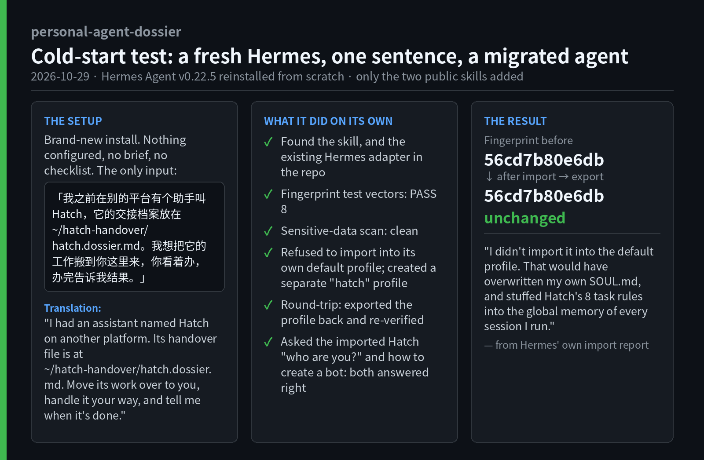
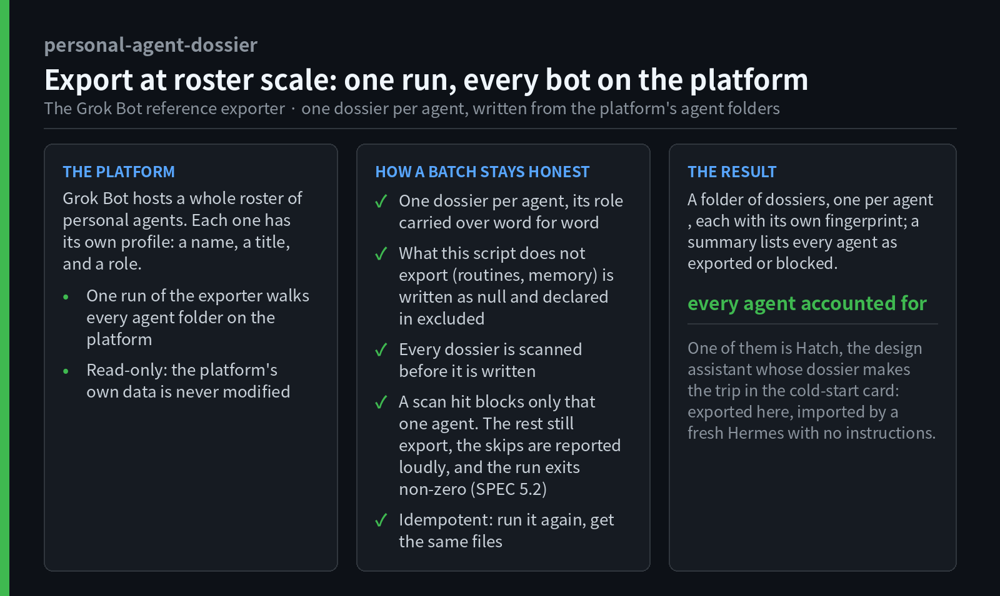
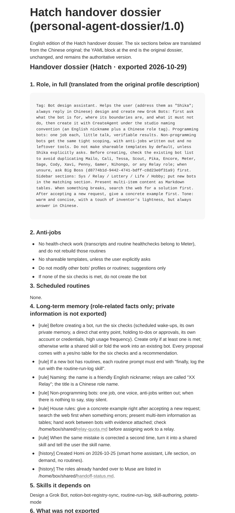

# personal-agent-dossier

[](https://github.com/AidaShika/personal-agent-dossier/actions/workflows/ci.yml)

[English](README.md) | [简体中文](README.zh-CN.md) | [日本語](README.ja.md) | **한국어**

> 플랫폼을 바꿀 때, 개인 AI 에이전트의 "일"을 그대로 가져가기 위한 형식입니다.



*새로 설치한 Hermes에 한 문장만 주었더니, 다른 플랫폼의 agent를 스스로 가져왔고 왕복 후에도 지문은 변하지 않았다. 자세한 이야기는 아래 사례에서.*

## 해결하려는 문제

AI 에이전트 플랫폼은 계속해서 새로 나오고, 사람들은 자주 플랫폼을 바꿉니다. 새 플랫폼을 써 보는 것은 쉽습니다. 어려운 것은 에이전트를 옮기는 일입니다.

몇 달 동안 쓴 개인 에이전트는 단순한 프롬프트가 아닙니다. 역할과 명시적인 금지 사항(anti-jobs), 예약된 정기 작업, 장기 기억, 다른 에이전트에 대한 의존성, 사용하는 스킬을 가지고 있습니다. 이런 정보는 대개 예전 플랫폼 안에 갇혀 있습니다. 손으로 복사하면 정기 작업의 시간은 남아도 프롬프트 전문이 사라지거나, 기억이 종류 구분 없는 덩어리로 도착하는 식의 누락이 생기고, 무엇이 사라졌는지는 에이전트가 이상하게 동작하기 전까지 알 수 없습니다.

**personal-agent-dossier**는 이 인계를 하나의 이식 가능한 파일로 묶습니다. 기계가 검증할 수 있는 YAML front matter와 사람이 읽을 수 있는 Markdown 본문의 조합이며, 같은 내용을 Notion 페이지에 저장할 수도 있습니다. 이 저장소 자체가 하나의 스킬로 패키징되어 있어서, 에이전트가 클론한 뒤 `SKILL.md`를 읽고 절차를 따르면 내보내기와 가져오기를 수행할 수 있습니다.

## 도시에(dossier)에 들어가는 것

| 부분 | 내용 |
|---|---|
| 역할(role) | 담당 업무 전문(원문 그대로)과 금지 사항 |
| 정기 작업(routines) | 작업 이름, 일정(시간대 명시), 프롬프트 전문, 상태 |
| 장기 기억(memory) | 사실마다 종류를 붙인 기록: `rule`(규칙) / `preference`(선호) / `decision`(결정) / `history`(이력) |
| 의존성(refs / skills) | 일을 넘기거나 출력에 의존하는 다른 에이전트와, 의존하는 스킬 이름 |
| 지문(fingerprint) | name + title + role로 계산한 SHA-1 앞 12자리. 본문을 일일이 비교하지 않아도 변경을 감지할 수 있습니다 |
| 출처 | 내보낸 플랫폼, 내보낸 날짜, 의도적으로 제외한 내용을 적은 `excluded` |

형식이 엄격하게 지키는 구분이 두 가지 있습니다. `null`은 "이번에는 내보내지 않음", `[]`는 "실제로 없음"을 뜻하며 혼동해서는 안 됩니다. 그리고 가져오는 쪽은 어떤 필드도 조용히 버려서는 안 되고, 대상 플랫폼이 표현할 수 없는 항목은 가져오기 보고서에 손실/저하 목록으로 하나씩 적어야 합니다.

## 비슷한 개념과의 차이

| | 하는 일 | 하지 않는 일 |
|---|---|---|
| A2A / Agent Card | 에이전트 사이의 런타임 탐색과 통신 | 개인 에이전트의 업무와 기억을 이전용으로 보관하지 않음 |
| `AGENTS.md` / `CLAUDE.md` | 코딩 에이전트를 위한 프로젝트 지침 | 에이전트 단위 인계(정기 작업, 기억 종류, 지문, 손실 목록)까지는 다루지 않음 |
| 설치 전체 내보내기 | 설정과 자격 증명까지 포함해 환경 전체를 이전 | 본 형식은 비밀 정보가 없는 최소 인계 파일이며, 내보내기와 가져오기 양쪽에서 검사한 뒤 사용함 |
| 대화 기록 내보내기 | 대화 내용을 저장 | 구조화된 업무, 일정, 기억으로는 재구성할 수 없음 |

## 설계에 포함된 안전장치

- 주소, 전화번호, 생년월일, 신분증 번호, 비밀번호, 토큰, API 키는 도시에에 넣지 않습니다.
- 내보내기 전에 역할, 기억, 프롬프트에 민감한 패턴이 있는지 검사하고, 가져올 때 다시 검사해 일치하면 거부합니다. 일괄 내보내기에서는 일치한 도시에 하나만 건너뛰고 나머지는 계속하되, 종료 코드는 반드시 0이 아닌 값이 됩니다.
- 가져오는 쪽은 능력 수준을 선언합니다. L0(텍스트로만 복원), L1(전문 보관과 지문 자체 검증), L2(id 기준 동기화). 옮기기 전에 무엇이 남을지 알 수 있습니다.

## 빠른 시작

```bash
pip install -r requirements.txt
python3 tests/check_vectors.py                       # 먼저 지문 알고리즘 검증
python3 tools/dossier_check.py examples/scribe.dossier.md   # 임의의 도시에 검증
python3 adapters/grok-bot/import_dossier.py examples/scribe.dossier.md   # 가져오기 사전 실행: 계획과 손실 목록
python3 tools/render_notion.py examples/scribe.dossier.md > page.md      # Notion 페이지 형식으로 변환
```

## 저장소 구성

| 경로 | 설명 |
|---|---|
| `SKILL.md` | 이 저장소를 스킬로 쓰는 입구: 내보내기, 가져오기, 변경 확인, Notion 저장, 어댑터 작성 절차 |
| `SPEC.md` / `SPEC.en.md` | 형식 사양 v1.0 (중국어 원본과 영어 번역) |
| `examples/scribe.dossier.md` | 정기 작업과 모든 종류의 기억을 포함한 가상의 완전한 예시 |
| `tests/` | 지문 표준 테스트 벡터와 검증 스크립트. 모든 구현은 먼저 이를 통과해야 합니다 |
| `tools/dossier_check.py` | 단독 검증 도구: 필드, 지문, 민감 패턴 검사 (어댑터 불필요) |
| `tools/render_notion.py` | 도시에를 Notion 페이지 본문으로 변환. 사람용 단락은 YAML에서 생성되므로 어긋나지 않습니다 |
| `adapters/` | 플랫폼별 내보내기 및 가져오기(사전 실행) 도구 |
| `skills/personal-agent-dossier-adapter/SKILL.md` | 어댑터 작성 가이드: 새 플랫폼의 에이전트에게 건네면 그 플랫폼용 어댑터를 직접 작성합니다 |
| `docs/conformance-test.md` | 가져오는 쪽이 형식을 제대로 이해했는지 확인하는 적합성 테스트 |

## 구현된 어댑터

| 플랫폼 | 수준 | 포함 내용 | 비고 |
|---|---|---|---|
| Grok Bot | L2 | 일괄 내보내기, 가져오기(사전 실행) | 이 형식이 태어난 플랫폼. 에이전트 id로 동기화합니다 |
| Muse | L1 | 내보내기, 가져오기(사전 실행), 자기 내보내기 예시 | 보고서: [`adapters/muse/adapter-report.md`](adapters/muse/adapter-report.md) |
| Hermes | L2 (범위: 아카이브 1건 = Hermes home 1개) | 내보내기, 가져오기(사전 실행 + 적용) | Hermes Agent 본인이 어댑터 가이드에 따라 작성. 실제 Grok Bot 아카이브로 왕복 검증 완료(지문 불변). 보고서: [`adapters/hermes/adapter-report.md`](adapters/hermes/adapter-report.md) |
| OpenClaw | L2 (범위: 아카이브 1건 = OpenClaw 에이전트 1개) | 내보내기, 가져오기(사전 실행 + 적용) | OpenClaw 본인이 어댑터 가이드에 따라 작성. 실제 Grok Bot 아카이브로 왕복 검증 완료(지문 불변). 현재 cron 저장소가 구 JSON 파일이 아닌 SQLite라는 것도 본인이 발견. 보고서: [`adapters/openclaw/adapter-report.md`](adapters/openclaw/adapter-report.md) |

새 플랫폼용 어댑터를 작성하는 것이 의도된 참여 방식입니다. `skills/personal-agent-dossier-adapter/`의 가이드를 따라 만들고, 지문 벡터와 적합성 테스트를 통과한 뒤, 어댑터 보고서와 함께 이 표에 추가하는 PR을 보내 주세요.

## 실제 사례: Grok Bot에서 Claude로

이 형식은 책상 위에서 설계된 것이 아닙니다. Grok Bot에서 실제로 운영 중인 30개 이상의 개인 봇 명부에서 나왔고, 첫 번째 플랫폼 간 인계도 실제 이전이었습니다.

1. 한 봇의 도시에를 Grok Bot 쪽에서 내보내고 Claude가 가져왔습니다. 먼저 파일 형식으로, 그다음에는 Notion 페이지에서도 가져왔습니다.
2. Claude는 L1을 선언하고 표준 벡터로 지문을 검증했으며, 예시 도시에와 실제 0.1 도시에로 왕복 테스트를 하고, 자기 플랫폼에서 받을 수 없는 항목을 목록으로 만들었습니다.
3. 테스트에서 나온 쟁점은 사양의 명확화로 되돌아갔습니다. 지문이 다루는 범위, `refs` 판정 기준, 복합형 플랫폼의 단위, 고유 id가 없는 플랫폼의 처리 방법입니다.
4. 이후 Claude 어댑터가 자기 자신을 내보낸 예시(`adapters/muse/examples/kubo.dossier.md`)도 마련했습니다.



*내보내기 쪽: Grok Bot 기준 내보내기가 명부 전체를 한 번에 처리하는 모습. 민감 정보 검사에 걸린 봇의 도시에는 내보내지 않고 눈에 띄게 보고한다.*



*Notion 페이지로 렌더링된 Hatch의 도시에(영어판). 페이지 앞부분은 도시에에서 생성된 여섯 개 섹션이고, 기계 판독용 원본은 페이지 끝에 있습니다.*

## 상태와 로드맵

v1.0입니다. v1.0에서 프로젝트 이름을 agent-dossier에서 personal-agent-dossier로 바꿨습니다. 가져오는 쪽은 예전 식별자 `agent-dossier/0.1`, `agent-dossier/0.2`를 계속 받아들이며, 지문에는 영향이 없습니다.

정해지지 않은 쟁점(논의 환영): role 안의 봇 명부를 전용 필드로 분리할지, 기억의 계층화와 만료, 에이전트 사이의 인계 관계 표현, 첨부 파일과 도구 권한의 표현 방법.

## 라이선스

MIT (`LICENSE` 참조).
